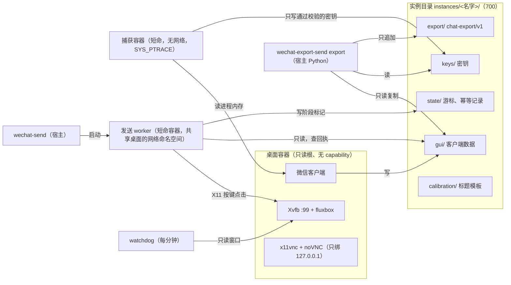
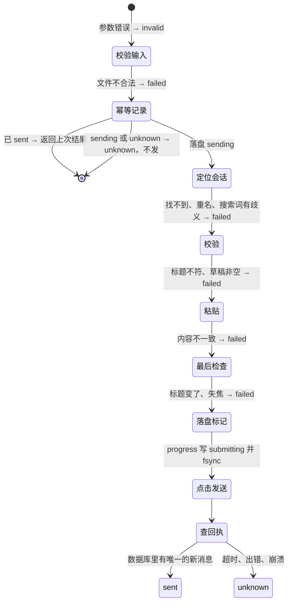

# 架构

## 总览



## 组件

| 组件 | 代码 | 运行在 | 说明 |
|---|---|---|---|
| 桌面容器 | `docker/desktop/` | 容器，常驻 | Xvfb、fluxbox、x11vnc、noVNC、supervisord；微信从 `client/<版本>/opt/wechat` 只读挂载 |
| 工具镜像 | `docker/tools/Dockerfile` | 容器，短命 | Python、gdb、libX11、libXtst |
| 密钥捕获 | `capture.py` | 工具容器 | gdb 硬件断点（默认）或 ptrace；逐库 HMAC 校验后才写 `keys/` |
| 解密 | `sqlcipher.py` | 宿主或工具容器 | SQLCipher 4 页格式，每页验证 HMAC；WAL 只应用已提交的帧 |
| 读库 | `wcdb.py` | 同上 | 解压、联系人、群、消息表 |
| 解析 | `message_parse.py` | 同上 | 把消息变成 `chat-export/v1` 的字段 |
| 媒体 | `media.py` | 同上 | 解 `.dat`，按内容寻址入库；缩略图绝不算原图 |
| 导出 | `exporter.py` | 宿主 | 增量、回看、待取图片、原子 manifest |
| 发送 | `send/host.py`、`send/worker.py`、`send/x11.py` | 宿主 + 工具容器 | 见下 |
| 看门狗 | `watchdog.py` | 宿主 + 工具容器 | 只读窗口，掉线和恢复时最多提醒一次 |
| 取原图（可选，默认关） | `originals.py` | 宿主 | 从腾讯 CDN 下载 pending 的原图 |
| 媒体服务（可选，默认关） | `media_origin.py` | 宿主 | 127.0.0.1 上凭 token 提供媒体文件 |
| 自检和 demo | `doctor.py`、`demo.py`、`synthetic.py` | 宿主 | |

## 导出的数据流

1. 取锁，一个实例同时只有一个导出。
2. 解密联系人库、会话库，得到账号和显示名。
3. 对每个 `message_N.db`：比较 (大小, mtime, inode)；没变化且没有待取图片就跳过。有变化就复制 DB 和 WAL，确认复制前后没变，校验并解密到 `state/export-XXXX/`。
4. 对每张 `Msg_<md5(账号)>` 表，取「`local_id` 大于游标」和「回看窗口内」的行。回看窗口内的行比较指纹：没变跳过，变了（撤回、编辑）用**同一个 id** 再写一行。
5. 自己刚发、还没有服务器 ID 的消息先不写，等拿到 ID，免得同一条消息换 ID 出现两次。
6. 按 `(ts, id)` 排好，先追加 JSONL 并 fsync，再原子替换 manifest 和游标。崩溃时最多多写几行，消费方本来就按 `(conversation_id, id)` 去重。残缺的最后一行下次写之前会截掉。
7. 删除所有解密副本。

消息 `id` 优先用服务器 ID（字符串），这样 `reply_to.id` 能直接对上；没有服务器 ID 的系统消息用 `l<分片号>_<local_id>`。

ID 哈希：`g_`（群）、`p_`（私聊）、`c_`（公众号）、`o_`（其他）、`u_`（人）、`a_`（账号）加上 `SHA-256(盐 + 账号)` 的前缀。盐在 `state/id-salt`，每个实例一份，第一次用到时生成，之后不变。

## 发送的状态机



分清 `failed` 和 `unknown` 的关键是**提交边界标记**：worker 在按下鼠标**之前**把 `submitting` 写进 `progress.json` 并 fsync。宿主不信任 worker 活到最后：

- worker 说 `failed`，但标记显示点过：改报 `unknown`。
- worker 没有回执（崩溃、被杀、docker 断连）：先确认容器已经停了；确认不了报 `unknown`（它可能还会去点）；标记显示点过报 `unknown`；没点过才报 `failed`。
- XTest 明确拒绝按下：这是唯一能在按下这一步报 `failed` 的情况。
- worker 说 `sent`，但没有提交记录，或回执后异常退出：报 `unknown`。

成功的判定很严：点击之后，目标会话的数据库里出现**唯一一条**新行，`local_id` 高于基线、自己发的（`origin_source=1`）、类型正确、服务器 ID 非零；文字还要求解码后 SHA-256 完全相等。

### 怎么确定点的是对的会话

1. 在联系人库里把 `--to` 解析成唯一账号；重名报错。搜索词如果还能匹配别的联系人或群，也报错。
2. 在搜索框输入全名（ASCII 直接按键；非 ASCII 经剪贴板粘贴），点第一条结果。
3. 把屏幕上的标题区域和这个会话校准时存的模板逐像素比较。提交前比较三次。没有模板就拒绝发送。

### 别的保护

- 输入框已有草稿就拒绝，绝不动用户写了一半的话。
- 窗口尺寸漂移时只把尺寸调回模板，登录窗口不动；其余校验照旧。
- 有意外的窗口或对话框弹出就拒绝。
- PNG 超过单次 X 请求上限（约 16.8MB）走 ICCCM INCR 分块，字节不变。
- 确认等待时间随文件大小增加：基础值 + 3 秒/MB，封顶 100 秒（基础值更大时取基础值）。
- 整个实例同时只有一个发送。

## 多账号

`instance create` 给每个实例分配独立的目录、compose 项目（`wes-<名字>`）、容器名（`wes-<名字>-desktop`）和 noVNC 端口。每个容器有自己的网络命名空间，所以 X 显示号都是 `:99`，互不相干。worker 用 `--network container:<桌面>` 进入对应容器的命名空间，经 X11 的抽象 socket 连上它。

## 目录

```
instances/<名字>/
  config.json        配置（docs/CONFIGURATION.md）
  instance.env       compose 用的环境变量
  gui/               客户端的 HOME，含真实聊天数据
  keys/              all_keys.json、passphrase.json、image_key.json（600）
  calibration/       ui-calibration.json（可选覆盖）、headers/<conversation_id>.png
  export/            chat-export/v1 输出
  state/             id-salt、export/（游标）、send/（幂等记录、证据）、watchdog/
client/<版本>/        解开的官方 deb
```
