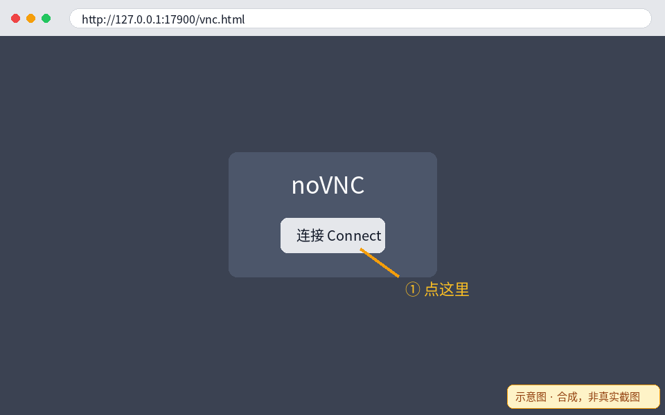
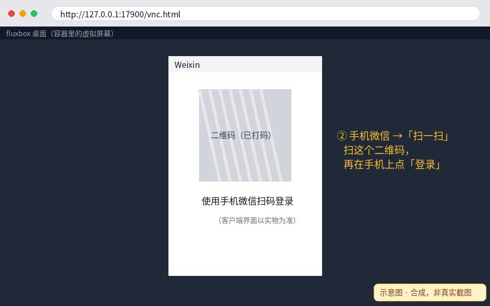

# 从零到第一份导出

这一篇从「刚拿到一台全新的 Linux 服务器」开始，分两段：

- **A 段：离线演示**（约 5 分钟）。不用微信账号、不用 Docker，任何架构都行。先确认程序在你的服务器上能跑。
- **B 段：接你自己的微信，拿到第一份真实导出**（约 30～60 分钟，大部分时间在下载）。需要：
  - 一台 **x86_64** 的 Linux 服务器（实测过 Debian 12、Ubuntu 24.04；ARM 机器跑不了 Linux 版微信）
  - 至少 2 GB 空闲内存、5 GB 空闲磁盘
  - 一部装了微信的手机（要扫码登录，这一步只能你自己做）
  - 会用 SSH 登录服务器、复制粘贴命令

> 约定：灰色框里的是要你输入的命令，一次复制一整行（或一整块）粘贴进终端，回车。`# 后面的文字` 是说明，不用输入。图里标着「示意图」的是画出来的，不是真实截图，真实界面以你看到的为准。

## A 段：离线演示

### 第 1 步：登录服务器，切换到 root

在你自己的电脑上打开终端（Windows 用 PowerShell，Mac 用「终端」）：

```sh
ssh 你的用户名@服务器地址
sudo -i
```

**应该看到**：提示符的结尾从 `$` 变成 `#`。要输入密码时，输入的是你这个用户的登录密码（屏幕上不显示，正常）。

> 为什么用 root：后面要用 Docker，普通用户默认没有权限。熟悉 Linux 的话也可以把自己加进 `docker` 组，用普通用户做。

### 第 2 步：装 Python

```sh
apt-get update && apt-get install -y python3 python3-venv
python3 --version
```

**应该看到**：`Python 3.10` 或更高，例如 `Python 3.12.3`。

### 第 3 步：把 release 包放到服务器上并校验

需要两个文件：`wechat-export-send-1.0.0.tar.gz` 和 `SHA256SUMS`。

- **服务器能上 GitHub**：

  ```sh
  cd /root
  curl -LO https://github.com/rmqg/wechat-export-send/releases/download/v1.0.0/wechat-export-send-1.0.0.tar.gz
  curl -LO https://github.com/rmqg/wechat-export-send/releases/download/v1.0.0/SHA256SUMS
  ```

- **文件在你自己的电脑上**：在**你的电脑**上运行 `scp wechat-export-send-1.0.0.tar.gz SHA256SUMS 你的用户名@服务器地址:/tmp/`，再回到服务器上运行 `mv /tmp/wechat-export-send-1.0.0.tar.gz /tmp/SHA256SUMS /root/`。

```sh
cd /root
sha256sum -c SHA256SUMS
tar -xzf wechat-export-send-1.0.0.tar.gz
cd wechat-export-send-1.0.0
```

**应该看到**：`wechat-export-send-1.0.0.tar.gz: OK`。是 `FAILED` 就重新下载，不要继续。

### 第 4 步：运行安装向导

```sh
./install.sh
```

它先检查环境，每一项是 `ok`、`提醒` 或 `缺少`；不是 `ok` 的后面有一行「怎么办」，写着要运行的命令。然后装 Python 依赖（要联网，约 1 分钟），再问你：

```
第 1 步：你想做什么？
  1) 只跑离线演示：不用账号、不联网，5 分钟看到导出结果
  2) 接我自己的微信账号：建实例、构建镜像、装客户端、启动桌面，然后扫码登录
```

输入 `1` 回车。（还没装 Docker 时默认就是 1。）

> **没有终端、或者用脚本安装时**（例如通过自动化工具执行命令，看不到提问）：`./install.sh` 会打印「不提问……只装了依赖」，这对 A 段已经够了，直接做第 5 步。

### 第 5 步：跑演示和自检

```sh
./bin/wechat-export-send demo
./bin/wechat-export-send doctor
```

**应该看到**：demo 打印 12 行 `ok`，例如 `ok  导出了一个群和一个私聊`，最后一行是 `导出结果在：/root/wechat-export-send-1.0.0/demo-output/export（全部是虚构数据）`。doctor 最后一行是 `结果：0 项失败，N 项警告`；这时关于 Docker 和「还没有实例」的警告是正常的。

想看导出长什么样：`ls demo-output/export/`，格式说明见 [CONTRACT.md](CONTRACT.md)。再跑一次 demo 要先 `rm -rf demo-output`。

A 段到此结束。只想了解一下的话可以停在这里。

## B 段：接你自己的微信

### 第 6 步：装 Docker

**Ubuntu**：

```sh
apt-get install -y docker.io docker-compose-v2
systemctl enable --now docker
```

**Debian 和其他发行版**（Docker 官方安装脚本，Engine 和 Compose 插件一起装）：

```sh
curl -fsSL https://get.docker.com | sh
```

然后确认两样都能用：

```sh
docker version --format '{{.Server.Version}}'
docker compose version
```

**应该看到**：一个版本号（例如 `29.1.3`），和一行以 `Docker Compose version` 开头的输出。第二条报 `'compose' is not a docker command` 就是没装 Compose 插件，按上面对应你系统的命令再装一次。

### 第 7 步：下载官方的 Linux 版微信（你自己做）

本项目不分发微信客户端。在**你的电脑**上打开微信官网 <https://linux.weixin.qq.com/>，下载 **x86_64 的 deb 包**（文件名类似 `WeChatLinux_x86_64.deb`），然后传到服务器：

```sh
# 在你的电脑上运行：
scp WeChatLinux_x86_64.deb 你的用户名@服务器地址:/tmp/
# 回到服务器上运行：
mv /tmp/WeChatLinux_x86_64.deb /root/
```

实测过的版本是 4.1.13.26。官网通常只给最新版，别的版本能不能用要自己试（见 [COMPATIBILITY.md](COMPATIBILITY.md)）。

### 第 8 步：再运行向导，选「接我自己的微信账号」

```sh
cd /root/wechat-export-send-1.0.0
./bin/wechat-export-send setup
```

它会依次问（括号里是推荐的回答）：

| 问题 | 回答 |
|---|---|
| 第 1 步：你想做什么？ | `2` |
| 第 2 步：实例名 | 直接回车（用 `main`） |
| 第 3 步：只导出哪些会话？ | 直接回车（全部）；只要某几个群就写群名，逗号隔开 |
| 第 4 步：现在构建镜像吗？ | 直接回车（是）。要下载约 1 GB，通常 5～15 分钟，屏幕会滚动很多下载日志，正常 |
| 第 5 步：deb 文件的路径 | `/root/WeChatLinux_x86_64.deb` |
| 第 6 步：现在启动桌面容器吗？ | 直接回车（是） |

最后它会跑一次自检，并打印「下一步做什么」，里面写着你的 noVNC 端口（第一个实例一般是 `17900`）。这时 doctor 里「账号目录」「数据库密钥」的警告是正常的：还没登录。

> **没有终端、或者用脚本安装时**：用答案文件代替上面的问答：
>
> ```sh
> cp install.env.example /root/install.env
> # 编辑 /root/install.env：WES_MODE=real，并去掉 WES_INSTANCE、WES_BUILD_IMAGES、WES_CLIENT_DEB、WES_START 前面的 #
> ./bin/wechat-export-send setup --answers /root/install.env
> ```

### 第 9 步：在浏览器里打开微信，扫码登录（你自己做）

noVNC 只在服务器本机上监听，要先从你的电脑开一条 SSH 隧道。在**你的电脑**上新开一个终端窗口：

```sh
ssh -L 17900:127.0.0.1:17900 你的用户名@服务器地址
```

这个窗口登录后**保持开着不要关**。然后在你电脑的浏览器里打开 <http://127.0.0.1:17900/vnc.html>，点「连接」：



连上后能看到容器里的桌面和微信的登录窗口。打开手机微信 →「扫一扫」，扫窗口里的二维码，再在手机上点「登录」：



等聊天列表出现，让它同步一两分钟。回到服务器的终端确认：

```sh
./bin/wechat-export-send doctor --instance main
```

**应该看到**：`[main] 账号目录: 已确定唯一账号目录`，`[main] 登录状态: online`。

> 浏览器里打不开：确认隧道那个窗口没有断开；端口不是 17900 的话，把命令和网址里的 17900 都换成向导打印的端口。

### 第 10 步：捕获数据库密钥（要在网页里重新登录一次）

```sh
./bin/wechat-export-send keys check --instance main
./bin/wechat-export-send keys capture --instance main --i-own-this-account
```

第二条打印「等待重新登录」后，回到浏览器的 noVNC 页面：在微信里**退出登录**，再扫码**登录一次**（手机上确认）。密钥在登录的那一刻被捕获。**应该看到**终端里打印：

```json
{"verified_databases": 12, "database_files": 12, "debugger_detached": true, "message_bodies_read": false}
```

（数字因账号而异，两个数相等就对了。）报错的话看 [TROUBLESHOOTING.md「密钥」](TROUBLESHOOTING.md#密钥)。

### 第 11 步：第一份导出

```sh
./bin/wechat-export-send export --instance main
./bin/wechat-export-send conversations --instance main
```

第一次要处理全部历史，消息多时要等几分钟。`export` 结束时打印一行 JSON 统计；`conversations` 列出导出了哪些会话。导出的文件在 `instances/main/export/`，格式见 [CONTRACT.md](CONTRACT.md)。

到这里，第一份真实导出就完成了。

## 接下来

- **定时导出、开机自启**：[INSTALL.md 第 12 步](INSTALL.md#12-长期运行)。
- **往群里发消息**：先校准、再 `--dry-run`，见 [INSTALL.md 第 11 步](INSTALL.md#11-发送)。
- **接总结工具**：[INTEGRATION.md](INTEGRATION.md)。
- **用完了要清理**：[INSTALL.md「卸载」](INSTALL.md#卸载)。

## 卡住了？

1. 先运行 `./bin/wechat-export-send doctor --instance main`，每个「失败」「警告」后面都有「修复：」一行，照着做。
2. 再按症状查 [TROUBLESHOOTING.md](TROUBLESHOOTING.md)。
3. 向导可以反复运行：`./bin/wechat-export-send setup`，已经做完的步骤会自动跳过。
